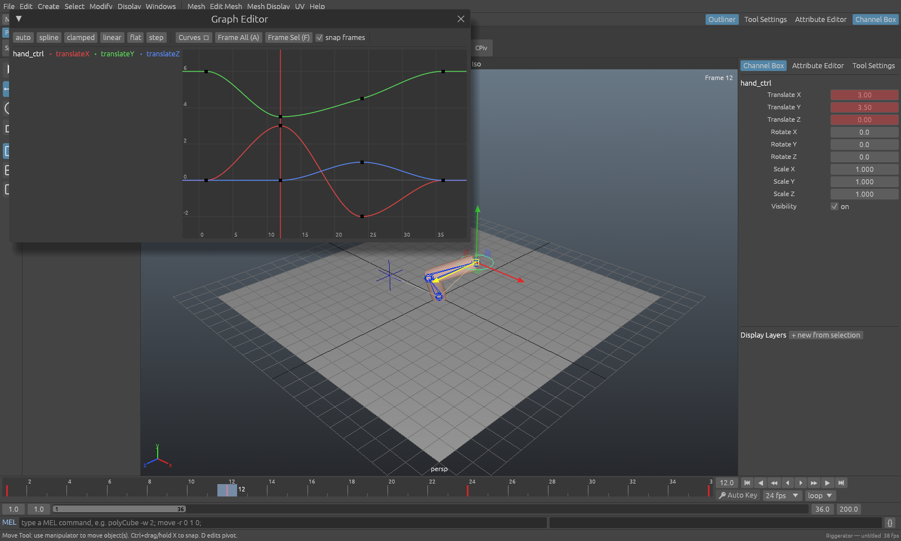
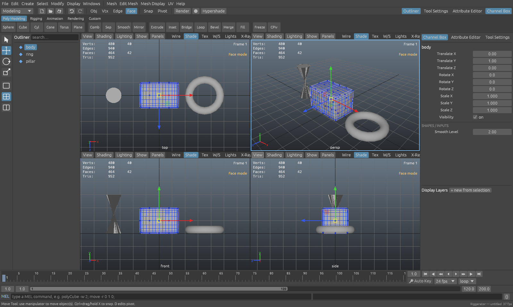
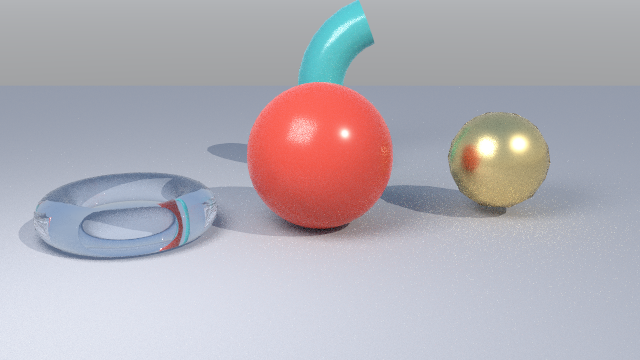

# Riggerator

**An open-source, Maya-style 3D modeling, rigging, animation and rendering application — written in pure Rust.**

Riggerator follows the layout, vocabulary and muscle memory of Autodesk Maya: the same menu sets, shelves,
Channel Box, Attribute Editor, Outliner, Graph Editor, Hypershade, time slider, Alt‑drag navigation,
QWER tools, F8–F11 component modes, marking menus, and a MEL‑compatible command language that every UI action
echoes into the Script Editor. It is a personal, for‑fun clean‑room project in the spirit of the
[storytold "craft" apps](https://github.com/storytold) (PhotoCraft, FilmCraft, …).

> Riggerator is **not** a Maya replacement for production work, and it is not affiliated with or endorsed by
> Autodesk. "Maya" is a trademark of Autodesk, Inc. No Autodesk code, assets or documentation were used.



| Modeling (four view, face mode, smooth preview, bevel, deformers) | Software render (path tracer) |
|---|---|
|  |  |

## Getting started

```sh
git clone https://github.com/stevenrogerino/riggerator
cd riggerator
cargo run --release -p riggerator                  # the app
cargo run --release -p riggerator -- --script examples/demo_rig.mel
cargo test --workspace                             # 64 unit tests across the crates
```

Linux needs the usual X11/Wayland + OpenGL 3.3 libraries (Mesa is fine). macOS and Windows build with the same
command. If your GPU/driver rejects 4× MSAA, the app retries without it (or set `RIGGERATOR_MSAA=0`).

Headless, like `mayabatch`:

```sh
cargo run --release -p rg-batch -- -script examples/showcase.mel -render out.png
cargo run --release -p rg-batch -- -file scene.rgs -command "render -sf 1 -ef 24 -o frames/shot_####.png;"
```

## What's in the box

### Workspace & UI (Maya conventions)
- Menu sets — **Modeling / Rigging / Animation / Rendering** — swap the right-hand menus, like Maya.
- Status line, shelves (Poly Modeling, Rigging, Animation, Rendering, Custom — Script Editor → *Save to Shelf*).
- Tool box (Select/Move/Rotate/Scale), single / four‑view / side‑by‑side layouts, **Space** toggles quad view.
- Viewport panel menus: *View* (persp/top/front/side/scene cameras, look through selected, frame, create camera
  from view), *Shading* (wireframe 4, smooth 5, textured 6, wire‑on‑shaded, X‑ray, backface culling),
  *Lighting* (default / all lights 7), *Show* filters, isolate select, HUD with poly counts.
- **Outliner** with search, drag‑and‑drop parenting, rename, context menu.
- **Channel Box** with keyed/animated/constrained/driven/locked colouring, multi‑object editing, channel
  context menu (key, lock, break connections), MMB **virtual slider**, SHAPES/INPUTS section, layer editor
  (visible / reference / colour).
- **Attribute Editor** (transform, mesh, material, skin cluster, blend shapes, deformers, camera, lights, joints,
  IK handles, extra attributes, notes), **Tool Settings**.
- Time slider with key ticks, range slider, playback controls, auto key, fps & loop modes, MEL command line
  with result field and history, help line.
- Hotkeys: QWER, Y, G (repeat last), Z / Shift+Z, Ctrl+D/G, P / Shift+P, S / Shift+W/E/R (keys), , . Alt+, Alt+.
  Alt+V, F/A, 1/2/3, 4/5/6/7, F8–F11, D (pivot), X (grid snap), J (rotate snap), +/-, Ctrl+H, Shift+H, arrow
  pick‑walk, Ctrl+A, Alt+A, F1 (hotkey list).

### Modeling (`rg-mesh`)
Polygon primitives (cube, sphere, cylinder, cone, torus, plane, pipe, platonic) with UVs and subdivisions ·
extrude faces (together/individual) and edges · inset · **bevel** (chamfer all edges) · insert edge loop ·
select edge loop / ring · bridge border loops · merge / merge to center · fill hole · delete faces / vertices /
dissolve edges · poke · triangulate / quadrangulate · **Catmull‑Clark smooth** and smooth mesh preview (1/2/3) ·
average vertices · mirror · combine / separate / extract · reverse normals · soft/hard edges (normal angle) ·
planar & cylindrical UV projection · UV Editor view · component editing of vertices/edges/faces with
manipulators, marquee and marking menus · freeze transforms · center pivot · pivot editing.

### Rigging (`rg-core`)
Joints with joint orient and *Orient Joint* · **IK handles** (ikRPsolver analytic two‑bone, FABRIK for longer
chains, ikSCsolver, pole vectors, twist, IK blend) · **constraints** (parent, point, orient, scale, aim,
pole vector; maintain offset; weights; blend) · **smooth skin** (closest‑bone weights with falloff, max
influences, envelope, editable weights in the Component Editor) · **blend shapes** · **nonlinear deformers**
(bend, twist, squash, flare, sine, wave) · **set driven keys** (window + MEL) · NURBS curve controls
(circle, square, arrow, any CV curve) with Maya override colours · display layers · templates · locked channels ·
user attributes (`addAttr`).

### Animation (`rg-anim`)
Keyframes on any keyable attribute · tangents *auto, spline, clamped, linear, flat, stepped, fixed* · pre/post
infinity *constant, linear, cycle, cycle with offset, oscillate* · **Graph Editor** (curve list, pan/zoom,
box select, drag keys with frame snapping, tangent handles, key stats, simplify) · **Dope Sheet** (retime
keys) · bake results (constraints/IK → keys) · auto key · playback in real time or every frame.

### Rendering (`rg-render`)
A multithreaded CPU **path tracer** with a SAH BVH, progressive Render View, quick preview pass, image save and
frame sequences: lambert/blinn/phong/**standardSurface**/surfaceShader, GGX specular, metalness, glass
(transmission + IOR), emission, opacity, checker/ramp/noise/file textures, directional/point/spot/area/ambient
lights with shadows and decay, sky dome, default light. **Hypershade** shows path‑traced material swatches.
The OpenGL viewport supports default lighting, all scene lights (up to 8), textures and X‑ray.

### Scripting (`rg-script`) — MEL‑compatible
Typed variables (`int float string vector`, arrays), `<<vectors>>`, `proc`s, `global`, `if/else`, `for`,
`for‑in`, `while`, `do/while`, `switch`, backtick command substitution, function‑style calls, `catch`, `eval`,
`source`, and 100+ Maya commands with their usual flags — `polyCube`, `move -r`, `setAttr -type double3`,
`setKeyframe -at`, `keyTangent`, `ikHandle -sj -ee`, `skinCluster`, `parentConstraint -mo`,
`setDrivenKeyframe -cd`, `shadingNode -asShader`, `hyperShade -assign`, `file -o/-s/-i/-es`, `render`, … Type
`help;` in the command line for the full list. Every UI action is echoed as MEL in the Script Editor.

```mel
string $ctrl[] = `circle -nr 0 1 0 -r 2 -n hand_ctrl`;
for ($i = 0; $i < 5; $i++) {
    string $b[] = `polyCube -w 1 -h 1 -d 1`;
    move -r ($i * 1.5) 0 0 $b[0];
    setKeyframe -at ty -t 1 -v 0 $b[0];
    setKeyframe -at ty -t (12 + $i * 2) -v 3 $b[0];
}
```

### Files (`rg-io`)
| Format | Read | Write | Notes |
|---|---|---|---|
| `.rgs` (Riggerator scene, JSON) | ✅ | ✅ | lossless: everything above |
| `.ma` (Maya ASCII subset) | ✅ | ✅ | transforms, joints, meshes (vt/ed/fc/uv/pnts), poly creator nodes (polyCube/Sphere/…), cameras, lights, locators, NURBS curves, lambert/blinn/phong/standardSurface + shading groups, anim curves |
| `.obj` + `.mtl` | ✅ | ✅ | groups/objects, UVs, materials, textures |
| `.gltf` | — | ✅ | evaluated meshes, hierarchy, PBR materials, embedded buffer |
| `.png` | — | ✅ | renders and sequences |

## Parity, measured honestly

"Full parity" with Maya — a 25‑year‑old product with thousands of nodes and plugins — is far outside what this
project is. Here is where Riggerator stands, dimension by dimension:

| Area | Status | What's missing compared with Maya |
|---|---|---|
| UI layout & workflow | **Strong** | Hotbox, customizable hotkeys/marking menus, docking/tear-off panels, preferences persistence |
| Polygon modeling | **Good** | Multi-cut, quad draw, edge-selection bevel with segments, booleans, retopo tools, sculpting, soft selection |
| NURBS / subdivision surfaces | **Minimal** | Only NURBS *curves* (for rig controls); no NURBS surfaces, lofts, revolves |
| UVs | **Basic** | UV Editor is view-only; no unfold/layout/cut/sew |
| Rigging | **Good** | Spline IK, HumanIK, ribbon/stretchy tools, paint skin weights brush, dual quaternion skinning, lattice/wire/cluster/wrap deformers, expressions |
| Animation | **Good** | Animation layers, Time Editor/Trax, motion trails, ghosting, weighted tangents, MotionBuilder-style tools |
| Dependency graph | **Partial** | Fixed evaluation order (driven keys → hierarchy → constraints → IK → deformers) instead of a general node graph; Node Editor is read-only |
| Rendering | **Good for look-dev** | Arnold features (AOVs, SSS, hair, volumes, denoiser, displacement), render layers, IPR |
| Dynamics / FX | **None** | nParticles, nCloth, Bifrost, fluids, XGen hair |
| Scripting | **MEL subset** | Python / maya.cmds / OpenMaya API, plugins |
| Interop | **Partial** | `.mb` binary, FBX, Alembic, USD; complex `.ma` with construction history beyond poly creator nodes |

Pull requests that close any of these gaps are welcome — the [architecture notes](docs/ARCHITECTURE.md) explain
where things live.

## Architecture

```
crates/
  rg-mesh     polygon kernel: primitives, modeling ops, triangulation, raycast
  rg-anim     animation curves (tangents, infinity, bake, simplify)
  rg-core     scene DAG, attributes, evaluation (constraints, IK, skin, deformers), undo, materials
  rg-io       .rgs / .ma / .obj / .gltf
  rg-render   path tracer (BVH, materials, lights, textures)
  rg-script   RigScript: MEL-compatible interpreter + Maya command set
apps/
  riggerator  egui + OpenGL desktop app (viewport, editors, windows)
  rg-batch    headless runner (mayabatch-style)
examples/     MEL scripts that build demo scenes
```

The UI is a thin layer: almost every action is a MEL command run through `rg-script`, which records one undo
step per command (snapshot undo; meshes are reference-counted so snapshots are cheap). See
[docs/ARCHITECTURE.md](docs/ARCHITECTURE.md).

## License

Apache-2.0. See [LICENSE](LICENSE).
